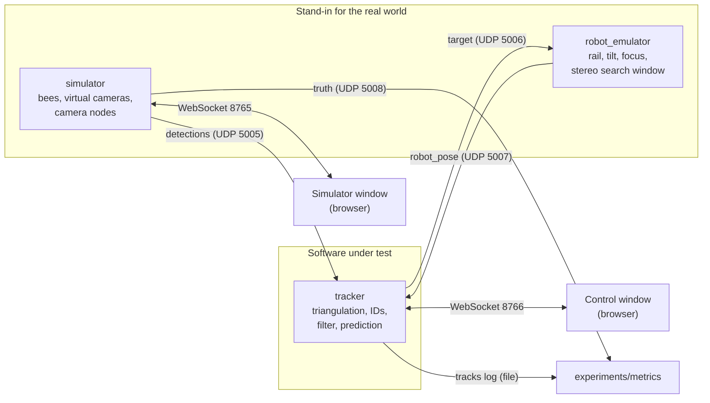

# Architecture

How the parts fit together and how they talk to each other. Update this file whenever a
component or a channel changes. Message fields are defined in `docs/protocol.md`.

Status: `shared/` and the simulator with its window are built (Stages 0 to 2).
Everything else is design. Each section notes the stage that builds it.

## Overview



One connection is missing on purpose: nothing flows from the simulator's ground truth to
the tracker.

## Components

### `shared/` (Stages 0 and 1)

Code both programs need, and nothing else.

- `config.py`: loads and validates `config/*.yaml` into dataclasses.
- `protocol.py`: builds and parses the messages of `docs/protocol.md`.
- `geometry.py`: camera model. Projects a 3D point to a pixel and turns a pixel into a ray.
  The simulator uses projection, the tracker uses rays, so both share one implementation of
  the lens model.

### `simulator/` (Stages 1 and 2)

Owns simulation time and the ground truth.

- Bee model: each bee is sitting, walking or flying. Positions advance once per frame.
  A flying bee lands only where it touches a wall, so it never jumps.
- Virtual cameras: project every visible bee into every camera, merge blobs that overlap
  in the image, add pixel noise and drop detections at random. Wall markers follow in
  Stage 6.
- Camera nodes: group two cameras per node, add the node's processing delay (one random
  delay per node and frame, shared by both cameras), and send one `detections` message per
  camera and frame. Node failure is not built yet.
- Sends `truth` once per frame.
- Serves the simulator window (page and WebSocket on one port) and accepts control changes
  from it (bee count, speed, noise, dropouts, pause, time scale, seed). Changes are applied
  between frames, so a run with the same seed and the same changes at the same frames
  repeats exactly.

### `robot_emulator/` (Stage 5)

Stands in for the existing camera robot and its software. Runs inside the simulator process
so it shares simulation time.

- Motion model for rail, tilt and focus with limits on speed and acceleration.
- Simulated stereo camera on the robot: narrow view, sees blobs with distance.
- Selection rule inside the search window (nearest to prediction, distance must fit, known
  other bees are excluded).
- Receives `target`, sends `robot_pose`.
- Provides the cinema camera's pose and focus distance to the simulator for rendering.

### `tracker/` (Stages 3 and 4)

The software under test. Knows nothing about the simulator.

- Receiver: collects `detections` and groups them by `frame`. Processes a frame when all
  expected cameras have reported or a timeout has passed.
- Triangulation: pixels to rays, rays to candidate 3D points, ghost rejection.
- Tracks: one Kalman filter per bee, assignment of points to tracks, track creation after a
  probation time, track removal after a time without support.
- Output: `target` for the selected track, a log of all tracks for the metrics.
- Serves the control window and accepts the selection from it.

### `experiments/` (Stages 3, 5 and 7)

- `metrics.py`: compares the tracker's log with `truth`. The only code allowed to read both.
- Scripts that run a configuration without windows and write results.

### Browser windows (Stages 2, 4 and 5)

Static pages served by each program, drawn with three.js. They hold no logic that affects
results. Each receives state snapshots over a WebSocket and sends user input back.

| Window | Shows | Sends back |
| --- | --- | --- |
| Simulator | True bee positions, cameras and view cones, robot model | Control changes |
| Control | Tracked bees with ID, trail and prediction, per-camera detections, system health, cinema view | Selected track ID |

The cinema view is rendered in the simulator window's process (it needs the truth) and is
shown in the control window as an image stream, the way a real video feed would arrive.

### Messages of the simulator window (WebSocket, port 8765)

JSON text frames. The same port serves the page itself at `http://127.0.0.1:8765/`.
Positions are in the arena frame in metres.

Simulator → page, once after the connection opens:

```json
{"type": "scene", "arena_size_m": [0.9, 0.3, 0.3],
 "cameras": [{"id": "cam-01", "position_m": [0, 0, 0], "look_at_m": [0.45, 0.15, 0.15],
              "fov_horizontal_rad": 1.919862}]}
```

Simulator → page, at most 30 times per second of wall time (also while paused):

```json
{"type": "state", "frame": 1042, "t": 17.366667, "seed": 1, "paused": false,
 "time_scale": 1.0,
 "settings": {"bee_count": 10, "max_speed_m_s": 5.0, "pixel_sigma_px": 0.5,
              "dropout_probability": 0.02},
 "bees": [{"id": 0, "pos": [0.41, 0.15, 0.17], "state": "flying"}]}
```

Page → simulator, one message per change:

```json
{"type": "control", "name": "bee_count", "value": 12}
```

| `name` | `value` | Effect |
| --- | --- | --- |
| `bee_count` | int, 0 to 200 | Bees are added (new ids) or the newest are removed |
| `max_speed_m_s` | float above 0, at most 20 | Speed limit of all bees |
| `pixel_sigma_px` | float, 0 or more | Pixel noise of all cameras |
| `dropout_probability` | float 0..1 | Chance that a detection is missed |
| `paused` | bool | Simulation time stops, no UDP messages are sent |
| `time_scale` | float, 0.01 to 100 | Simulation seconds per second of wall time |
| `seed` | int | Restart at frame 0 with this seed and the current settings |

A change takes effect at the start of the next frame. An invalid message is ignored.

## Timing

- The simulator advances in fixed steps of one frame period (default 1/60 s).
- A `detections` message for frame `n` carries the exposure time of frame `n` and arrives
  after the node delay. In real-time mode the simulator sleeps until each message's send
  time; with `--fast` it sends them in send-time order without waiting.
- The tracker's estimate for frame `n` is therefore already old when it is ready. `target`
  carries the time its position is valid for, and the robot extrapolates from there.
- The robot emulator runs at a higher control rate (default 500 Hz) between frames.

## What would change with real hardware

Only the left box. Real camera nodes would send the same `detections` messages
(`docs/camera-node.md`), and the real robot software would speak `target` and `robot_pose`
(`docs/robot-interface.md`). The tracker stays as it is.
