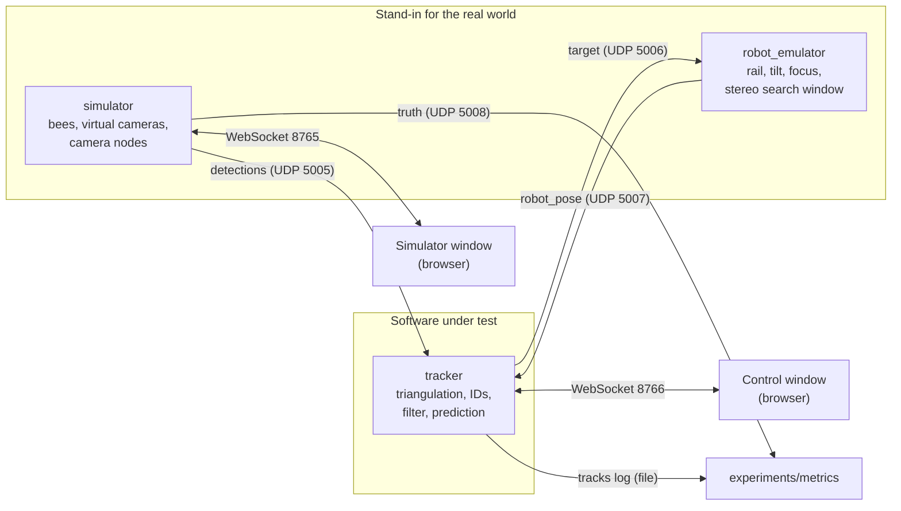

# Architecture

How the parts fit together and how they talk to each other. Update this file whenever a
component or a channel changes. Message fields are defined in `docs/protocol.md`.

Status: design. Nothing is implemented yet. Each section notes the stage that builds it.

## Overview

One connection is missing on purpose: nothing flows from the simulator's ground truth to
the tracker.

## Components

### `shared/` (Stage 0)

Code both programs need, and nothing else.

- `config.py`: loads and validates `config/*.yaml` into dataclasses.
- `protocol.py`: builds and parses the messages of `docs/protocol.md`.
- `geometry.py`: camera model. Projects a 3D point to a pixel and turns a pixel into a ray.
  The simulator uses projection, the tracker uses rays, so both share one implementation of
  the lens model.

### `simulator/` (Stages 1 and 2)

Owns simulation time and the ground truth.

- Bee model: each bee is sitting, walking or flying. Positions advance once per frame.
- Virtual cameras: project every visible bee into every camera, add pixel noise, drop
  detections at random, and report wall markers at a low rate.
- Camera nodes: group two cameras per node, add the node's processing delay, and send one
  `detections` message per camera and frame. A failed node sends nothing for both cameras.
- Sends `truth` once per frame.
- Serves the simulator window and accepts control changes from it (bee count, speed, noise,
  dropouts, pause, time scale, seed).

### `robot_emulator/` (Stage 5)

Stands in for the existing camera robot and its software. Runs inside the simulator process
so it shares simulation time.

- Motion model for rail, tilt and focus with limits on speed and acceleration.
- Simulated stereo camera on the robot: narrow view, sees blobs with distance.
- Selection rule inside the search window (nearest to prediction, distance must fit, known
  other bees are excluded).
- Receives `target`, sends `robot_pose`.
- Provides the cinema camera's pose and focus distance to the simulator for rendering.

### `tracker/` (Stages 3 and 4)

The software under test. Knows nothing about the simulator.

- Receiver: collects `detections` and groups them by `frame`. Processes a frame when all
  expected cameras have reported or a timeout has passed.
- Triangulation: pixels to rays, rays to candidate 3D points, ghost rejection.
- Tracks: one Kalman filter per bee, assignment of points to tracks, track creation after a
  probation time, track removal after a time without support.
- Output: `target` for the selected track, a log of all tracks for the metrics.
- Serves the control window and accepts the selection from it.

### `experiments/` (Stages 3, 5 and 7)

- `metrics.py`: compares the tracker's log with `truth`. The only code allowed to read both.
- Scripts that run a configuration without windows and write results.

### Browser windows (Stages 2, 4 and 5)

Static pages served by each program, drawn with three.js. They hold no logic that affects
results. Each receives state snapshots over a WebSocket and sends user input back.

| Window | Shows | Sends back |
| --- | --- | --- |
| Simulator | True bee positions, cameras and view cones, robot model | Control changes |
| Control | Tracked bees with ID, trail and prediction, per-camera detections, system health, cinema view | Selected track ID |

The cinema view is rendered in the simulator window's process (it needs the truth) and is
shown in the control window as an image stream, the way a real video feed would arrive.

## Timing

- The simulator advances in fixed steps of one frame period (default 1/60 s).
- A `detections` message for frame `n` carries the exposure time of frame `n` and arrives
  after the node delay.
- The tracker's estimate for frame `n` is therefore already old when it is ready. `target`
  carries the time its position is valid for, and the robot extrapolates from there.
- The robot emulator runs at a higher control rate (default 500 Hz) between frames.

## What would change with real hardware

Only the left box. Real camera nodes would send the same `detections` messages
(`docs/camera-node.md`), and the real robot software would speak `target` and `robot_pose`
(`docs/robot-interface.md`). The tracker stays as it is.
