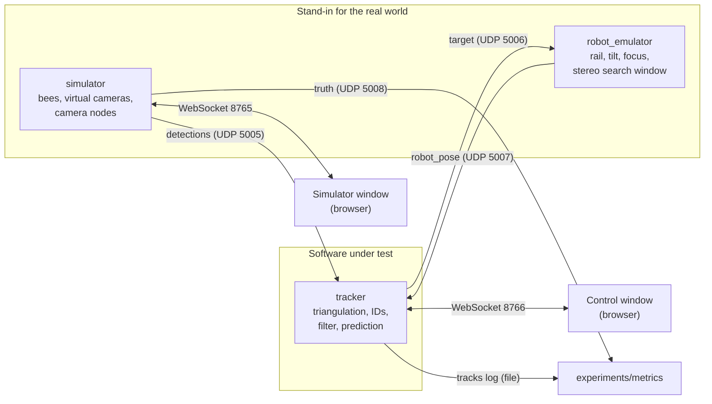

# Architecture

How the parts fit together and how they talk to each other. Update this file whenever a
component or a channel changes. Message fields are defined in `docs/protocol.md`.

Status: `shared/`, the simulator and the tracker with their windows and the metrics are
built (Stages 0 to 4).
Everything else is design. Each section notes the stage that builds it.

## Overview



One connection is missing on purpose: nothing flows from the simulator's ground truth to
the tracker.

## Components

### `shared/` (Stages 0 and 1)

Code both programs need, and nothing else.

- `config.py`: loads and validates `config/*.yaml` into dataclasses.
- `web.py`: serves a window's page on the port of its WebSocket.
- `protocol.py`: builds and parses the messages of `docs/protocol.md`.
- `geometry.py`: camera model. Projects a 3D point to a pixel and turns a pixel into a ray.
  The simulator uses projection, the tracker uses rays, so both share one implementation of
  the lens model.

### `simulator/` (Stages 1 and 2)

Owns simulation time and the ground truth.

- Bee model: each bee is sitting, walking or flying. Positions advance once per frame.
  A flying bee lands only where it touches a wall, so it never jumps.
- Virtual cameras: project every visible bee into every camera, merge blobs that overlap
  in the image, add pixel noise and drop detections at random. Wall markers follow in
  Stage 6.
- Camera nodes: group two cameras per node, add the node's processing delay (one random
  delay per node and frame, shared by both cameras), and send one `detections` message per
  camera and frame. A node stopped from the simulator window sends nothing for both cameras.
- Sends `truth` once per frame.
- Serves the simulator window (page and WebSocket on one port) and accepts control changes
  from it (bee count, speed, noise, dropouts, pause, time scale, seed). Changes are applied
  between frames, so a run with the same seed and the same changes at the same frames
  repeats exactly.

### `robot_emulator/` (Stage 5)

Stands in for the existing camera robot and its software. Runs inside the simulator process
so it shares simulation time. All its values come from `config/robot.yaml`.

- `motion.py`: rail, tilt and focus as axes with limits on speed and acceleration.
- `stereo.py`: the stereo camera on the robot (105° view): blobs with image position, size
  and measured distance, with noise. It moves and tilts with the cinema camera.
- `controller.py`: the robot's software. It extrapolates the last `target` to now, applies
  the selection rule in the search window (nearest to the prediction, distance must fit,
  not explained by a bee in `others`), falls back to the prediction when no blob
  qualifies, and commands the axes with feed-forward from the bee's velocity. Without a
  `target` for `target_timeout_s` it holds position.
- Receives `target`, sends `robot_pose` after every control step.

Geometry (in `shared/geometry.py`, because the tracker and the metrics need it too): the
rail runs along +x from `rail.start_m`. The tilt axis is parallel to the rail. At tilt 0 the
cameras look along +y. So the rail follows the bee in x, the tilt in z, and the focus in y.

One simulator frame with the robot:

1. `truth` is built with the robot axes as they are at the frame time.
2. The tracking cameras observe, the nodes build `detections`.
3. The robot runs its control steps up to the next frame time (8 or 9 steps at 500 Hz). A
   stereo exposure that is due is taken at the start of a control step.
4. The bees move.

`target` datagrams from the tracker are taken in between two frames. The robot therefore
needs the simulator to run in real time: with `--fast` the tracker falls behind, the
`target` messages are older than `target_timeout_s` and the robot holds position.

### `tracker/` (Stages 3 and 4)

The software under test. Knows nothing about the simulator.

- Receiver: collects `detections` and groups them by `frame`. Processes a frame when all
  expected cameras have reported or a timeout has passed.
- Triangulation: pixels to rays, rays to candidate 3D points, ghost rejection.
- Tracks: one Kalman filter per bee, assignment of points to tracks, track creation after a
  probation time, track removal after a time without support.
- Output: `target` for the selected track after every frame (once a `robot_pose` has
  arrived), a log of all tracks for the metrics.
- Input from the robot: `robot_pose`. The newest one gives `distance_m` and the list of
  other bees in the robot's stereo image.
- `--auto-select` selects the oldest confirmed track whenever none is selected, for runs
  without a control window.
- Serves the control window (page and WebSocket on one port), sends it a snapshot at most
  30 times per second of simulation time, and accepts the selection from it.
- Health: a node counts as stopped when none of its cameras has reported for
  `node_silent_after_s` of simulation time.
- Restart: when frame numbers jump back by more than 10 frames, the sender has restarted.
  The tracker then drops all tracks and starts again; track IDs keep counting up.

What the tracker does with one frame (Stage 3):

1. Predict every track to the frame's exposure time.
2. Known bees first: per camera, each track claims the ray nearest to its prediction
   (within `claim_gate_m`). The claimed rays give a least-squares point. A point counts
   only if the usual share of the cameras covering that place agrees.
3. New points from the rays that are left: pairs of rays that nearly meet, supported by
   further cameras. Points with the most cameras are accepted first, and a ray supports
   only one point. At least three cameras, more where more cameras cover the place.
4. Tracks without a point from step 2 take the nearest new point (within
   `assignment_gate_m`). Points that are left start a track on probation.
5. One line is written to the track log.

Track log (`logs/tracks.jsonl`, one JSON object per line and frame):

```json
{"frame": 1042, "t": 17.366667, "selected": 4,
 "tracks": [{"id": 4, "pos": [0.412, 0.1503, 0.1711], "vel": [0.8, -0.12, 0.05],
             "acc": [0.0, 0.0, 0.0], "state": "flying", "confirmed": true, "cameras": 7}]}
```

`selected` is the ID of the selected track or `null`.

`confirmed` is false while a track is on probation. `cameras` is the number of cameras
behind the track's point in this frame, 0 when the track ran on prediction alone.

### `experiments/` (Stages 3, 5 and 7)

- `metrics.py`: compares the tracker's log with `truth`. The only code allowed to read both.
  Robot metrics: the share of frames in which the selected bee is inside the cinema frame,
  and the share in which it is in the frame and within the depth of field. The selected bee
  is the true bee nearest to the selected track (within the match gate).
- Scripts that run a configuration without windows and write results.

### Browser windows (Stages 2, 4 and 5)

Static pages served by each program, drawn with three.js. They hold no logic that affects
results. Each receives state snapshots over a WebSocket and sends user input back.

| Window | Shows | Sends back |
| --- | --- | --- |
| Simulator | True bee positions, cameras and view cones, robot model | Control changes |
| Control | Tracked bees with ID, trail and prediction, per-camera detections, system health, cinema view | Selected track ID |

The cinema view is drawn by the simulator window (it needs the truth): every bee in the
narrow view of the cinema camera as a disc whose edge gets softer with its distance from
the focus plane. The page sends the picture as JPEG images (binary WebSocket messages,
about 15 per second) to the simulator, which passes them on unchanged to every client
connected to `ws://127.0.0.1:8765/cinema`. The control window connects there and shows the
images, the way a real video feed would arrive. The tracker never sees them. The cinema
view needs an open simulator window.

### Messages of the simulator window (WebSocket, port 8765)

JSON text frames. The same port serves the page itself at `http://127.0.0.1:8765/`.
Positions are in the arena frame in metres.

Simulator → page, once after the connection opens:

```json
{"type": "scene", "arena_size_m": [0.9, 0.3, 0.3],
 "cameras": [{"id": "cam-01", "position_m": [0, 0, 0], "look_at_m": [0.45, 0.15, 0.15],
              "fov_horizontal_rad": 1.919862}],
 "nodes": [{"id": "node-01", "cameras": ["cam-01", "cam-02"]}],
 "body_length_m": 0.015,
 "robot": {"rail_start_m": [0.0, -0.15, 0.15], "rail_length_m": 0.9, "lens_offset_m": 0.0,
           "cinema_fov_horizontal_rad": 0.096, "cinema_aspect_ratio": 1.7778,
           "depth_of_field_m": 0.002}}
```

Simulator → page, at most 30 times per second of wall time (also while paused):

```json
{"type": "state", "frame": 1042, "t": 17.366667, "seed": 1, "paused": false,
 "time_scale": 1.0,
 "settings": {"bee_count": 10, "max_speed_m_s": 5.0, "pixel_sigma_px": 0.5,
              "dropout_probability": 0.02, "rail_max_speed_m_s": 2.0,
              "rail_max_acceleration_m_s2": 20.0, "tilt_max_speed_rad_s": 10.0,
              "tilt_max_acceleration_rad_s2": 200.0},
 "robot": {"rail_m": 0.392, "tilt_rad": 0.11, "focus_m": 0.215, "has_target": true},
 "stopped_nodes": ["node-03"],
 "bees": [{"id": 0, "pos": [0.41, 0.15, 0.17], "state": "flying"}]}
```

Page → simulator, one message per change:

```json
{"type": "control", "name": "bee_count", "value": 12}
```

| `name` | `value` | Effect |
| --- | --- | --- |
| `bee_count` | int, 0 to 200 | Bees are added (new ids) or the newest are removed |
| `max_speed_m_s` | float above 0, at most 20 | Speed limit of all bees |
| `pixel_sigma_px` | float, 0 or more | Pixel noise of all cameras |
| `dropout_probability` | float 0..1 | Chance that a detection is missed |
| `paused` | bool | Simulation time stops, no UDP messages are sent |
| `time_scale` | float, 0.01 to 100 | Simulation seconds per second of wall time |
| `seed` | int | Restart at frame 0 with this seed and the current settings |
| `node_stopped` | `{"node_id": "node-03", "stopped": true}` | A stopped node sends nothing for both of its cameras; `false` starts it again |

| `rail_max_speed_m_s` | float above 0, at most 20 | Speed limit of the rail |
| `rail_max_acceleration_m_s2` | float above 0, at most 500 | Acceleration limit of the rail |
| `tilt_max_speed_rad_s` | float above 0, at most 100 | Speed limit of the tilt axis |
| `tilt_max_acceleration_rad_s2` | float above 0, at most 5000 | Acceleration limit of the tilt axis |

A change takes effect at the start of the next frame. An invalid message is ignored. The
robot limits set here last until the simulator stops; a run always starts with the values
of the robot file.

Page → simulator, binary: one JPEG image of the cinema view. Simulator → clients on the
path `/cinema`: the same images, unchanged.

### Messages of the control window (WebSocket, port 8766)

JSON text frames. The same port serves the page at `http://127.0.0.1:8766/`.

Tracker → page, once after the connection opens:

```json
{"type": "scene", "arena_size_m": [0.9, 0.3, 0.3], "prediction_lead_s": 0.1, "min_cameras": 3,
 "cinema_port": 8765,
 "robot": {"rail_start_m": [0.0, -0.15, 0.15], "rail_length_m": 0.9, "lens_offset_m": 0.0},
 "cameras": [{"id": "cam-01", "position_m": [0, 0, 0], "look_at_m": [0.45, 0.15, 0.15],
              "fov_horizontal_rad": 1.919862, "width_px": 1456, "height_px": 1088}],
 "nodes": [{"id": "node-01", "cameras": ["cam-01", "cam-02"]}]}
```

Tracker → page, at most 30 times per second of simulation time:

```json
{"type": "tracks", "frame": 1042, "t": 17.366667, "selected": 4,
 "tracks": [{"id": 4, "pos": [0.412, 0.1503, 0.1711], "vel": [0.8, -0.12, 0.05],
             "acc": [1.2, 0.0, -0.4], "pred": [0.492, 0.1383, 0.1761],
             "state": "flying", "confirmed": true, "cameras": 7}],
 "detections": {"cam-01": [[512.31, 300.87, 14.2, 4], [901.05, 644.4, 9.8, -1]]},
 "health": {"silent_nodes": ["node-03"], "camera_age_s": {"cam-01": 0.0}},
 "robot": {"rail_m": 0.392, "tilt_rad": 0.11, "focus_m": 0.215}}
```

| Field | Meaning |
| --- | --- |
| `selected` | ID of the selected track, or `null` |
| `tracks[].acc` | Smoothed acceleration (time constant `acceleration_smoothing_s`) |
| `tracks[].pred` | Position predicted `prediction_lead_s` ahead of `t` |
| `tracks[].cameras` | Cameras behind the track's point in this frame, 0 on prediction alone |
| `detections` | Per camera: `[u, v, size, track_id]`; `track_id` is -1 for a detection no track used |
| `health.silent_nodes` | Nodes whose cameras have all been silent for `node_silent_after_s` |
| `health.camera_age_s` | Simulation time since each camera last reported |
| `robot` | Axes of the newest `robot_pose`, or `null` before the first. The window draws the robot from these and from the robot file, never from the truth |

Page → tracker:

```json
{"type": "select", "track_id": 4}
```

`track_id` is a track ID or `null` to clear the selection. The selection is cleared by the
tracker when the track is removed. An invalid message is ignored.

## Timing

- The simulator advances in fixed steps of one frame period (default 1/60 s).
- A `detections` message for frame `n` carries the exposure time of frame `n` and arrives
  after the node delay. In real-time mode the simulator sleeps until each message's send
  time; with `--fast` it sends them in send-time order without waiting.
- The tracker's estimate for frame `n` is therefore already old when it is ready. `target`
  carries the time its position is valid for, and the robot extrapolates from there.
- The robot emulator runs at a higher control rate (default 500 Hz) between frames.

## What would change with real hardware

Only the left box. Real camera nodes would send the same `detections` messages
(`docs/camera-node.md`), and the real robot software would speak `target` and `robot_pose`
(`docs/robot-interface.md`). The tracker stays as it is.
