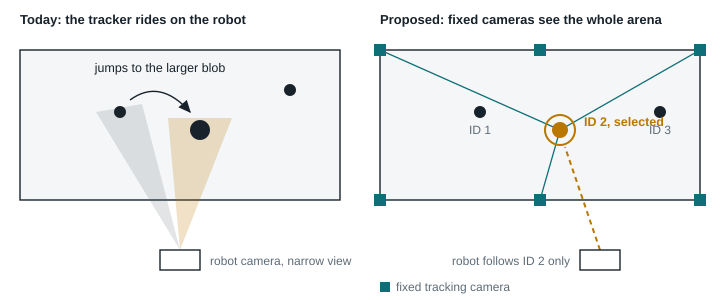
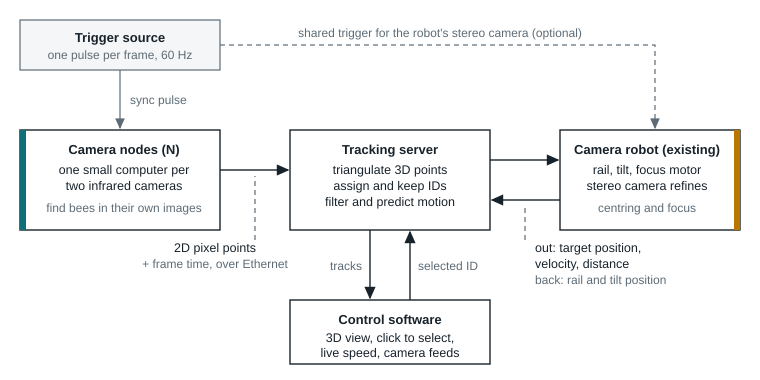
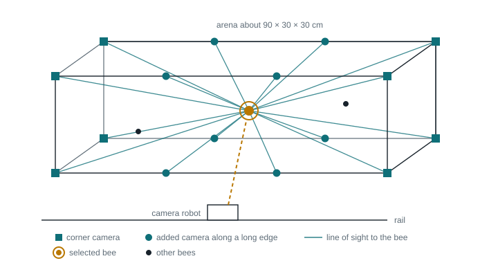
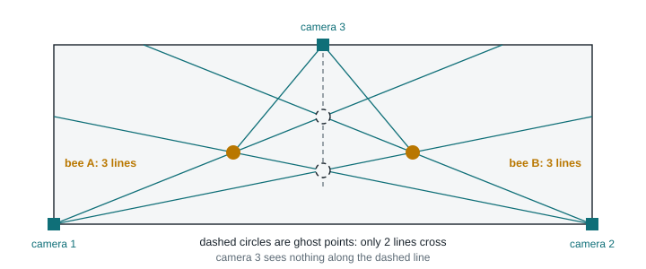
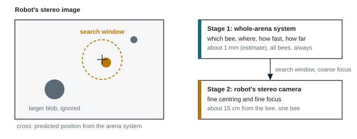
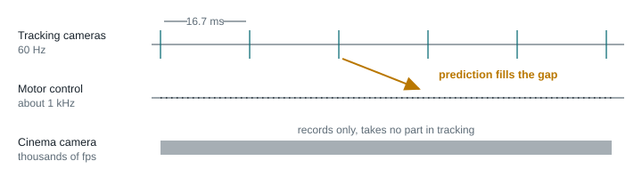
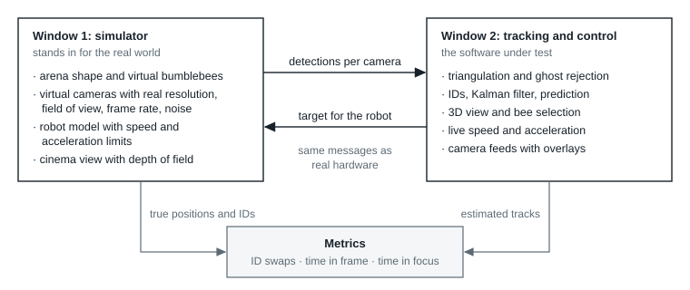

# Whole-arena 3D tracking for a bumblebee camera robot

Concept paper. Also available as [PDF](concept-paper.pdf).

Luke Stark · 13 November 2026 · Written with Claude

Idea stage. Nothing here has been built or tested yet.

**Summary**

Jeremy Fielding's camera robot follows a flying bumblebee with a macro lens. Its tracker sits on the robot and follows the largest yellow blob it can see, so with several bees in the arena the camera jumps from one bee to the next.

My idea is to add a second, fixed system: several small cameras mounted around the flight arena that see every bumblebee at once, compute each bee's 3D position, and give each bee a stable ID. An operator picks one bee in a control program, and the robot receives where that bee is, where it will be a moment later, and how far away it is. The robot keeps its own stereo camera for fine centring and fine focus.

This paper describes the idea, the problems it is meant to solve, the functions it needs, and how I currently picture the system. The first goal is a software proof of concept that runs against a simulation with realistic hardware parameters.

## 1. Where the idea comes from

I watched Jeremy Fielding's "Engineer vs Bee" series, in which he designs and builds a high-speed camera robot for a group of science filmmakers in Berkeley. The aim is to film bumblebees in flight in colour, at roughly 1.5× magnification and at thousands of frames per second, with the camera chasing the bee the way a broadcast camera follows a swimmer. I find the project and what he has achieved so far fascinating.

While watching the field test I noticed that the camera kept switching between bees. That made me think about tracking from the outside instead of from the robot: if cameras fixed to the arena could see all bumblebees at the same time, the system would always know which bee is which. The jumping would disappear, and a piece of software could let you choose which bee to follow.

## 2. The robot today

This is my understanding of the current robot, taken from the four videos.

- **Motion.** A cinema camera with a 180 mm macro lens travels on a linear rail and tilts up and down. A motor turns the focus ring.
- **Sensing.** A calibrated stereo camera pair rides on the robot. It uses wide lenses (about 105° field of view), a 50 mm baseline, and works at about 150 mm from the bee. It measures the distance to the bee, and a measured curve converts that distance into a focus-ring position.
- **Detection.** OpenCV looks for yellow against a black background and puts a box around the largest blob. Searching the full image runs at about 32 Hz. Once a bee is found the search shrinks to the area around its last position and runs at about 60 Hz.
- **Compute.** A Jetson runs vision and motor control. The vision code is written in C++.
- **Arena.** An acrylic and mesh flight chamber of about 3 ft × 1 ft × 1 ft, connected to a colony and lit from the sides, because bees fly toward light and otherwise bump against the ceiling.

The requirements are hard. Bumblebees can fly at about 5 m/s and reverse direction in under 50 ms. At macro magnification the focus has to be right to within 1 to 2 mm, and small camera movements are clearly visible in the picture.

## 3. Problems I hope to solve

The filmmakers want several bees in the arena, because interactions between bees are the interesting footage. The current tracker was designed around one bee. The table lists the problems shown in the videos and what a whole-arena tracker could contribute to each.

| Problem                                        | Cause in the current system                                                                                                                                                                                                                   | Contribution of whole-arena tracking                                                                                                                                               |
|------------------------------------------------|-----------------------------------------------------------------------------------------------------------------------------------------------------------------------------------------------------------------------------------------------|------------------------------------------------------------------------------------------------------------------------------------------------------------------------------------|
| **The camera jumps between bees**              | The tracker follows the largest yellow blob. A bee that passes closer to the lens looks larger and takes over.                                                                                                                                | Every bee has an ID. The robot follows the selected ID, whatever else enters its view.                                                                                             |
| **A lost bee is hard to find again**           | The robot's view is narrow. Once the bee leaves it, the tracker does not know where to look.                                                                                                                                                  | The fixed cameras always see the whole arena and can point the robot back at the bee.                                                                                              |
| **The camera lags behind in flight**           | Prediction ("feed forward") needs the bee's velocity. The stereo camera moves with the robot, so robot motion and flex are mixed into the measurement. On the tilt axis a 3D-printed part flexed by almost 2°, about 7 mm at 200 mm distance. | Fixed cameras measure the bee's position and velocity in the room, independent of robot motion. The robot still has to know its own pose, so the mechanical fix is needed as well. |
| **Dead zone: steady picture or fast reaction** | A 2 to 3 mm dead zone keeps the picture calm while a bee sits, but gives a departing bee a head start. It is switched by hand.                                                                                                                | The 3D velocity shows whether the bee is sitting or flying, so the mode could switch automatically.                                                                                |
| **Focus hunts or lags**                        | Focus updates at 20 Hz to avoid visible hunting. In fast flight that is too slow.                                                                                                                                                             | The distance to the bee is known and predicted. Focus can move ahead of the bee, and the update rate can follow the flight state.                                                  |
| **Switching to another bee**                   | Not possible on purpose. The tracker chooses by blob size.                                                                                                                                                                                    | Clicking a bee in the software re-aims the robot and presets focus before the bee is in view.                                                                                      |

*Figure 1. The difference in one picture. Today the robot decides what to follow from its own narrow view. In the proposal, cameras fixed to the arena identify every bee, and the robot is told which one to follow.*

## 4. The idea

The principle is the one used in optical motion capture. Several calibrated cameras look at the same volume from known positions. Each camera sees a bee as a point in its image, and that point defines a straight line from the lens into the arena. Where the lines from several cameras meet is the bee's position in 3D. Motion-capture systems use reflective markers and infrared flashes for this. Here the bees themselves are the objects, so no markers are needed.

Three properties make this useful for the robot:

- **It sees everything.** Every bee in the arena is tracked all the time, including the ones the robot is not looking at.
- **It keeps identities.** Each bee gets an ID in the first frame and keeps it, because the system remembers where each bee was and where it was heading.
- **It does not move.** The cameras are bolted to the arena, so their measurements are not disturbed by the robot's motion or vibration.

The whole-arena system does not replace the robot's stereo camera. The two work in stages: the arena system answers "which bee, where, how fast, how far", and the robot's own camera, which is much closer to the bee, does the last millimetres of centring and focus.

## 5. How I picture the system

### 5.1 Architecture

*Figure 2. Data flow. Camera nodes send only coordinates, never images. The server turns them into tracked 3D positions. The robot receives data for the selected bee and reports its own rail and tilt position back.*

### 5.2 Camera nodes

Each node is one small computer with two cameras attached, so 16 cameras need 8 nodes. The two cameras of a node are neighbours, because camera ribbon cables are short. The node finds the bees in both images and sends a short message per camera and frame: its node ID, the camera ID, the time the frame was taken, and the pixel coordinates of every bee that camera sees. A single camera cannot know how far away a bee is, so it sends image positions only. Distance comes from combining cameras on the server.

Sending coordinates in place of images keeps messages to a few bytes and keeps delay short and predictable. Jeremy describes in his third video why unpredictable transfer times are a problem for prediction. Wired Ethernet with small UDP packets avoids most of that, and one cable can also carry power (PoE).

Sharing a computer has two consequences for the design. A node has to process two images within one frame time, and when a node fails, two neighbouring cameras disappear together. The layout should tolerate that.

### 5.3 Synchronisation

All cameras must expose at the same instant. A bee at 5 m/s moves about 8 mm in a tenth of a frame at 60 Hz, so unsynchronised cameras would place it at different points. A single trigger source sends one pulse per frame to every camera. Because every frame then has an exact time, the server can predict cleanly from it.

### 5.4 Infrared for tracking, visible light for filming

The tracking cameras would work in near infrared, around 850 nm, with infrared LEDs lighting the arena and an infrared-pass filter on each lens. The reasoning:

- Bumblebees do not see near infrared, so the light should not influence their behaviour.
- The cinema camera has an infrared-blocking filter, so the colour picture is unaffected.
- The large film lights are LEDs and emit very little infrared, so the filters remove most of their glare from the tracking images.
- Acrylic is transparent to near infrared, so cameras could also sit outside the chamber. This differs from the thermal camera Jeremy tried, which works at much longer wavelengths that acrylic blocks.

With a fixed background, detection can start simple: subtract the empty arena and look for moving blobs. A trained detector can come later if needed.

The black background the filmmakers want does not rule infrared out. What counts is the contrast between bee and background in the infrared image, and there are two ways to get it:

- **Bright bee, dark background.** The black must also be dark in infrared. That is usually the case for materials coloured with carbon black, such as many matt black paints and flock foils.
- **Dark bee, bright background.** Many black-dyed synthetic fabrics and black anodised aluminium are bright in infrared. The cinema camera would see black, and the tracking cameras would see dark bees against a bright surface. Silhouettes like this are a common method in insect research.

How a material behaves in infrared cannot be seen by eye and has to be tested per product with an infrared camera. I also do not know yet how bright a bumblebee itself is at 850 nm.

With cameras all around the arena, every camera has its own background. Often it is the transparent wall opposite and the room behind it. Sides that are not filmed through should be covered, so that movement outside the chamber does not disturb detection.

**Colour as the alternative.** Jeremy's tracker finds the yellow of the bee, which is simple and needs no extra light. For cameras all around the arena I plan with infrared for now: cameras facing the film lights would be dazzled, the acrylic reflects the lamps, the yellow is probably not equally visible from every direction, and tracking would depend on how the scene is lit for filming. Detection is an exchangeable module. Triangulation, IDs and prediction only receive points and do not depend on how the points were found.

### 5.5 Camera placement

My starting point is one camera in every corner, aimed at the centre of the arena. Corners give very different viewing angles onto the same bee, which is what makes the 3D position accurate, and they keep the cameras out of the film camera's picture.

The chamber is long and narrow. Cameras at the two ends are far from the middle, so I would add cameras along the long edges. More cameras also give redundancy: if one is blocked, covered by a bee, or fails, the others still see the bee.

Each corner camera needs a wide lens of roughly 110° or more to cover the volume. Wide lenses distort the image, so calibration has to use a fisheye model.

*Figure 3. Example layout with 16 cameras on 8 nodes: one camera in each corner and two more along each long edge. In open space every camera has a line of sight to the bee, so far more than the required three agree. Top cameras look down and bottom cameras look up. The right number and positions are a question for the simulation.*

### 5.6 Hardware I am assuming

I do not have the resources to build this, so the hardware below is an assumption used to give the simulation realistic numbers. All of it is inexpensive, off-the-shelf equipment.

| Part            | Assumption                                                                                                              | Why                                                                                                                                     |
|-----------------|-------------------------------------------------------------------------------------------------------------------------|-----------------------------------------------------------------------------------------------------------------------------------------|
| Tracking camera | Raspberry Pi Global Shutter Camera class: Sony IMX296, 1456 × 1088 px, about 60 fps, monochrome, external trigger input | Global shutter avoids skewed images of fast bees and makes synchronisation simple. Very short exposures are possible with enough light. |
| Lens and filter | Wide-angle lens, about 110°, with an 850 nm infrared-pass filter                                                        | Covers the arena from a corner and removes the visible film lights.                                                                     |
| Camera node     | One Raspberry Pi 5 class computer per two cameras. It has two camera ports.                                             | Halves the number of computers: 8 nodes for 16 cameras. Runs detection for both images locally and sends coordinates.                   |
| Trigger         | A microcontroller that outputs one pulse per frame                                                                      | Raspberry Pi documents this method for synchronising several global-shutter cameras.                                                    |
| Network         | Wired Ethernet, UDP, optionally PoE                                                                                     | Short, predictable delay. One cable per node.                                                                                           |
| Tracking server | An ordinary computer on the same network                                                                                | The load is small: 16 cameras on 8 nodes × 20 bees × 60 Hz is about 19,000 points per second.                                           |

## 6. The tracking pipeline

### 6.1 From pixels to lines

The server knows each camera's position, orientation and lens model from calibration. With that it converts every received pixel coordinate into a line in arena coordinates.

### 6.2 From lines to 3D points

Because of measurement noise, lines from different cameras never meet exactly. The server looks for places where lines pass within a few millimetres of each other and takes the point closest to all of them.

With several bees there is a trap. Lines that belong to different bees can cross by chance at a place where no bee is. I call these ghost points. A point therefore only counts as a bee if at least three cameras agree on it.

*Figure 4. Why three cameras must agree. With two cameras and two bees, the four lines cross at four places and two of them are false. A third camera confirms the real bees and has no line through the ghosts.*

Three cameras make ghosts much rarer but do not exclude them. With many bees, three lines from three different bees can still nearly meet. Four more safeguards work together with the three-camera rule:

- **Every detection counts once.** A point in a camera image may belong to only one bee. The server accepts the 3D points with the most supporting cameras first. A ghost would need detections that already belong to a real bee and drops out.
- **Known bees first.** The server knows from prediction where every tracked bee should be and assigns detections to those tracks first. Only what is left over can become a new bee.
- **Probation.** A new point gets an ID only after it has been present for several frames in a row and moves like a bee. Ghosts usually appear for one or two frames and then jump away.
- **More than three where possible.** With 8 to 16 cameras, five or more typically see the same bee. The threshold can depend on how many cameras should be able to see that place.

How often a ghost still gets through depends on the number of bees and the tolerance. The simulation can measure that.

### 6.3 IDs and motion state

For every bee the server keeps a track: its ID, current position, velocity and acceleration. A Kalman filter with an acceleration model is the standard tool for this. In every frame it predicts where each known bee should now be, and the new 3D points are assigned to the nearest predictions (the Hungarian algorithm does this assignment for all bees at once). A bee keeps its ID because its new position fits its own prediction better than anyone else's.

If a bee is hidden for a few frames, its track continues on prediction alone and picks the bee up again when it reappears.

### 6.4 Prediction

The same filter can state where a bee will be at any moment in the near future. That is the value the robot needs, because every measurement is already slightly old when it arrives. Jeremy calls the use of this value feed forward.

The state also shows what the bee is doing. A bee with near-zero velocity is sitting or walking, and a bee with high velocity or sudden acceleration is flying. That signal could switch the robot's dead zone and focus update rate automatically.

### 6.5 Expected accuracy

A rough estimate with the assumed camera: at 50 cm distance, with two cameras 30 cm apart and detection accurate to half a pixel, the position error is about 1 mm. More cameras improve this. A bumblebee of 15 mm at that distance covers about 15 pixels, enough to detect reliably. These numbers are estimates from geometry, and checking them is one purpose of the simulation.

About 1 mm is enough to aim the robot, predict motion and preset focus. It is not enough for final macro focus on its own, which is why the robot's close-range stereo camera stays in charge of that.

## 7. Handing the bee to the robot

### 7.1 A search window in the robot's own image

The server projects the predicted 3D position of the selected bee into the image of the robot's stereo camera. The robot's vision then searches only a small window around that point and ignores everything outside it. If the window contains a bee, the robot uses its own measurement to centre, because it is closer and faster. If the window is empty, or the detection suddenly jumps, the robot follows the prediction until the bee reappears. When the two systems disagree, the whole-arena system decides.

A smaller search area should also help the robot's vision keep its 60 Hz rate at all times, and possibly exceed it.

*Figure 5. Two-stage tracking. The arena system keeps the robot on the right bee and the robot's own camera does the precise work inside a small window.*

The window alone is not enough. If the robot kept choosing the largest blob, a larger bee flying through the window would still take over. Inside the window the robot therefore checks three things:

- **Nearest, not largest.** The robot takes the blob closest to the predicted point. A bee passing through is near that point for only a few frames.
- **The distance must fit.** A bee usually looks larger because it is closer to the lens. The stereo camera measures the distance of every blob, and the arena system knows the distance of the target. A blob at the wrong distance cannot be the target.
- **The other bees are known too.** The arena system tracks every bee, so it also projects the bees that are about to cross the robot's view into the image. The robot knows in advance that a blob belongs to another ID.

If another bee hides the target from the robot, the distance check rejects the measurement and the robot follows the prediction until the target is free again. The fixed cameras usually still see the target, because they look from other directions. Focus stays on the target's distance throughout, so a bee passing in front is out of focus.

### 7.2 Focus

My current view is that focus should stay with the robot's stereo camera during normal tracking, because at about 15 cm it measures distance more precisely than cameras in the corners can. The arena system adds three things:

- **Preset on selection.** When the operator clicks a new bee, the distance from the lens to that bee is already known. Focus moves to it while the camera is still swinging over, so the bee arrives nearly sharp.
- **Fallback.** If the stereo camera loses the bee briefly, the arena distance keeps focus approximately right.
- **Lead.** Predicted distance lets focus move ahead of a bee that flies toward or away from the camera.

### 7.3 Timing with a high-speed camera

The cinema camera may record thousands of frames per second while tracking runs at 60 Hz. That is not a conflict, because the cinema camera takes no part in tracking. It only records. What has to match is the tracking cameras and the robot's stereo camera, both near 60 Hz, ideally on the same trigger.

*Figure 6. Different rates side by side. The filter can be asked for the bee's position at any instant, so motor control can run much faster than the cameras.*

### 7.4 Messages

Three small messages carry everything. Field names are a first proposal. A node sends one detections message per camera and frame.

| Message    | From → to            | Content                                                                                                                                |
|------------|----------------------|----------------------------------------------------------------------------------------------------------------------------------------|
| Detections | Camera node → server | node_id, camera_id, frame_time, bees \[ (u, v, blob_size), … \], markers \[ (marker_id, u, v), … \]                                    |
| Target     | Server → robot       | track_id, time, position (x, y, z), velocity, acceleration, distance_to_lens, confidence, others_in_view \[ (track_id, position), … \] |
| Robot pose | Robot → server       | time, rail_position, tilt_angle, focus_position                                                                                        |

## 8. Calibration

Jeremy describes stereo calibration as the part of his project he dreaded most. The calibration here should therefore be simple and use things that are already there. I assume that the robot's dimensions are known from its CAD model and that the robot stands in a fixed place relative to the arena.

One tool does everything: a small LED on a stick.

### 8.1 Tracking cameras

The LED is moved through the whole arena while all cameras record. Every camera sees the same point at the same time, from every direction, which a checkerboard cannot offer when cameras face each other. From these observations the positions and orientations of all cameras are computed together (bundle adjustment). This is how commercial motion-capture systems are calibrated.

### 8.2 Robot position and focus in one pass

The LED is then held at 10 to 20 places in the arena. At each place the operator centres it in the cinema camera's picture and focuses on it with focus peaking, the way Jeremy already does for his focus curve. The system stores three things per place: the LED's 3D position from the tracking cameras, the robot's rail and tilt readings, and the focus motor position.

A least-squares fit over these points gives the robot's exact position and orientation in arena coordinates. The same points give a focus curve that maps arena distance straight to focus motor position. That removes the question of which physical point on the lens the distance is measured from, and nothing has to be measured with calipers.

### 8.3 Wall markers as a permanent check

The researchers recommend a faint dot pattern on the chamber walls so that bees see the walls and do not collide with them. These dots can serve a second purpose. They are fixed marks at known positions, so every camera can check continuously whether it still sees them where calibration says they should be. If a camera is bumped, the system notices at once, reports which camera it is, and can correct that camera's pose from the marks.

A regular dot pattern is ambiguous, because one dot looks like the next. A few unique marks between the dots, for example small ArUco codes, would resolve that. Whether such marks are acceptable for the bees and for the picture is an open question.

## 9. What the control software should do

- Show the arena in 3D with every tracked bee, its ID, a short trail of its recent path and its predicted position.
- Let the operator select a bee with a click. The robot swings to it and presets focus.
- Show live values for the selected bee: speed, acceleration (smoothed for display), distance to the lens, and whether it is sitting or flying.
- Show the cinema camera's live picture, and each tracking camera's view with a box and ID on every detected bee, so that it is visible that tracking works.
- Show system health: how many cameras currently see each bee, which cameras or nodes are not delivering, and which cameras have drifted from their calibration.
- Guide the operator through the two calibration passes.

## 10. Proof of concept: a hardware-faithful simulation

Since I cannot build the hardware, the first goal is a proof of concept in software that is more than a sketch: the real tracking software, running against a simulation that behaves like the hardware would. The two parts are separate programs and talk to each other with the same network messages real camera nodes and a real robot would use. In principle the simulator could later be swapped for hardware without changing the tracking software.

A simulation has one advantage real bees never offer. It knows the true position and identity of every bee at every moment, so tracking errors and ID swaps can be counted exactly.

*Figure 7. The proof of concept. The simulator replaces bees, cameras and robot. Comparing its ground truth with the tracker's output gives objective numbers.*

### 10.1 What the simulator should offer

- A window that shows what is happening, with controls for the number of bees, their flight behaviour and speed, measurement noise, camera dropouts and delay.
- A 3D model of the robot that moves according to the commands it receives, within realistic speed and acceleration limits.
- The cinema camera's view, rendered with a narrow field of view and blur that depends on focus distance, so it is visible whether the bee stays centred and sharp.
- Optional wall markers and a control that nudges a camera out of position, to test whether the software notices and corrects it. The markers can be switched off to compare.
- Repeatable runs, so the same flight can be replayed with different settings.

### 10.2 Configurable arena and cameras

The first arena is the rectangular chamber. Arena shape and camera placement should live in a configuration file and not in the code, so that other shapes, such as a narrow tunnel or a chamber with obstacles, and other camera layouts can be tried later. Camera models are separate entries with their own resolution, field of view, frame rate and noise.

The configuration also states which two cameras share a node. The simulator then behaves like the hardware would: a node sends the messages of both its cameras, both share the node's processing delay, and a failed node removes two cameras at once.

A coverage map would be a useful extra: for a grid of points in the arena, how many cameras see each point and how accurately it can be located. That answers placement questions before any bee flies.

### 10.3 Questions the simulation should answer

- How many cameras are needed, and where, for a given arena?
- How often does a ghost point get through, and which safeguards matter most?
- What happens when a whole node with two cameras fails?
- How reliably is a displaced camera detected and corrected from the wall markers?
- How often do IDs swap, as a function of the number of bees and how closely they pass each other?
- How much of the time does the selected bee stay in the cinema frame and within the depth of field?
- How much delay between exposure and motor command can the system tolerate?

### 10.4 Software choices so far

Python for the simulation and the tracking server, with NumPy for the geometry. The data volume is small enough for that. The work is split into separate processes for network input, tracking and display. Both windows run in the browser and use three.js for 3D. Parts that turn out to be too slow can be moved to C++ later. The robot's own software is C++ already.

## 11. Limits and open questions

- **Bees that sit close together.** Bumblebees land, walk, and climb over each other. When two bees touch for a longer time, their IDs can swap, because bumblebees look alike. Small numbered tags, as used in bee research, would solve this but may not be wanted in cinematic footage.
- **The robot must know its own pose.** Aiming from arena coordinates relies on correct rail and tilt readings. Mechanical flex that the encoders do not see, like the 2° problem in the video, would still cause errors.
- **Integration needs Jeremy.** The search window, the target message and the focus preset change the robot's software. Everything up to the target message can be developed independently.
- **Cameras facing each other.** If infrared LEDs sit next to the lenses, opposite cameras see them as bright spots. These spots are fixed and can be masked, or the lighting can be diffuse and indirect.
- **Background in infrared.** Both background variants in section 5.4 depend on how the chosen black material and the bees themselves look at 850 nm. Only a test with an infrared camera can answer that.
- **Wall patterns and detection.** The dot pattern is static, so background subtraction should remove it, but a bee in front of a dark dot may be harder to see. The simulation cannot answer this, because its virtual cameras deliver points and not images. It needs real hardware.
- **Bees on lenses.** Bumblebees like corners. Cameras inside the chamber need a small cover, or they sit outside behind the acrylic and must cope with reflections.
- **Simulation is not reality.** Reflections, trigger jitter, real flight behaviour and calibration errors will differ from the model. A good simulation result shows that the concept and the software work in principle. It does not prove the hardware.

**About this paper.** The idea and the design decisions are Luke Stark's. Claude, Anthropic's AI model, gave technical feedback and suggestions during the discussion, collected the facts and ideas, drew the figures and wrote the text.

Sources: Jeremy Fielding's "Engineer vs Bee" video series (rounds 1 to 3 and the tracking test video) for the robot, the arena and the measured values quoted in sections 2 and 3. Raspberry Pi's documentation for the Global Shutter Camera for sensor, resolution and external trigger. All accuracy and data-rate figures for the proposed system are my own estimates.
